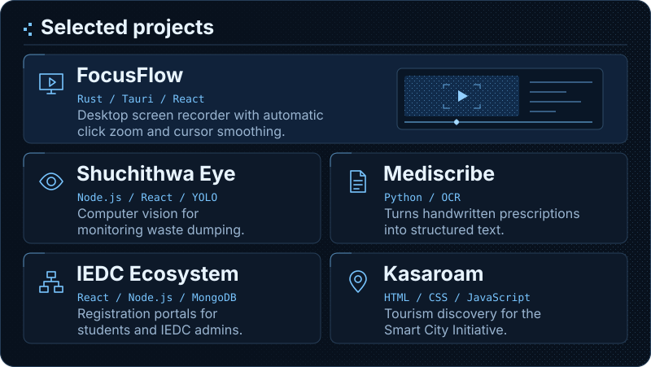

  

  <a href="https://umaralmukhtar.dev/">Portfolio</a> ·
  <a href="https://linkedin.com/in/umaralmukhtaribrahimkutty">LinkedIn</a> ·
  <a href="https://instagram.com/umaralmukhtar_">Instagram</a> ·
  <a href="mailto:umar1868807@gmail.com">Email</a>
   
  <a href="https://github.com/UmarAlMukhtar/FocusFlow">FocusFlow on GitHub</a> ·
  <a href="https://github.com/iedclbscek/iedc-ecosystem">IEDC Ecosystem on GitHub</a>

  

  

