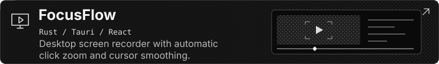
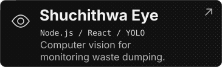
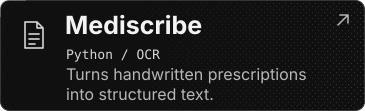
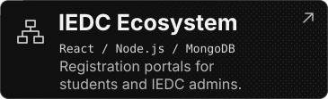
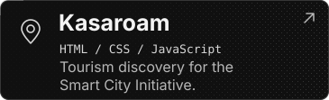

  

  <a href="https://umaralmukhtar.dev/">Portfolio</a> ·
  <a href="https://linkedin.com/in/umaralmukhtaribrahimkutty">LinkedIn</a> ·
  <a href="https://instagram.com/umaralmukhtar_">Instagram</a> ·
  <a href="mailto:umar1868807@gmail.com">Email</a>

  

<h2 align="center">Selected projects</h2>

  

  
  

  
  

